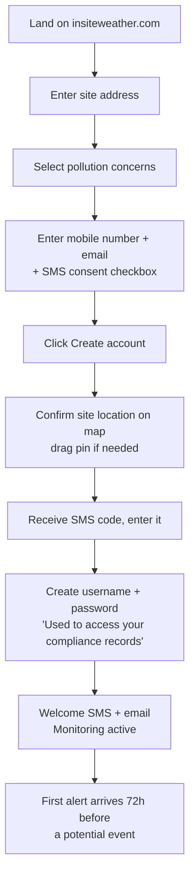
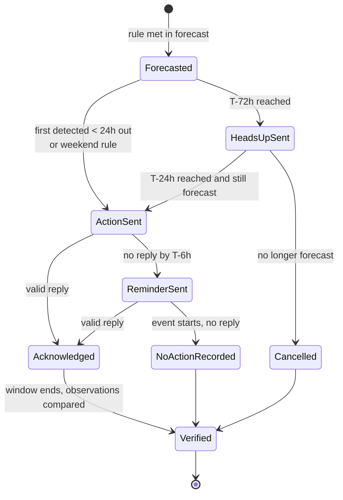
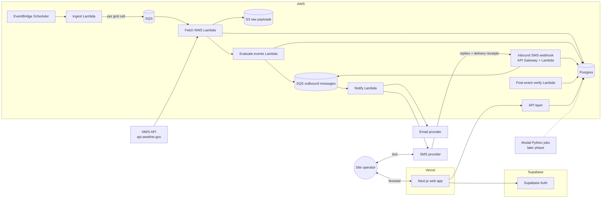

# InSite Weather: Product Requirements Document

| | |
|---|---|
| **Product** | InSite Weather (working name; domain candidate `insiteweather.com`) |
| **Document status** | Draft v0.1 |
| **Last updated** | 2026-11-15 |
| **Product owner** | _TBD_ |
| **Engineering / design leads** | _TBD_ |
| **Target launch** | _TBD_ (see §11 for proposed phasing) |

> **How to read this document**
> Content marked **[ASSUMPTION]** was not in the source brief and was drafted to make the PRD complete. Each one needs confirmation.
> Content marked **[OPEN]** is an unresolved decision, tracked in §10.3.

---

## Table of contents

1. [Summary](#1-summary)
2. [Problem and opportunity](#2-problem-and-opportunity)
3. [Users](#3-users)
4. [Goals and success metrics](#4-goals-and-success-metrics)
5. [Scope](#5-scope)
6. [Functional requirements](#6-functional-requirements)
7. [Non-functional requirements](#7-non-functional-requirements)
8. [Technical architecture](#8-technical-architecture)
9. [Go-to-market and rollout](#9-go-to-market-and-rollout)
10. [Risks, assumptions, and open questions](#10-risks-assumptions-and-open-questions)
11. [Milestones](#11-milestones)
12. [Appendix](#12-appendix)

---

## 1. Summary

InSite Weather is a low-touch SMS and email alert service for industrial facilities (quarries, aggregate yards, construction sites, recycling yards and similar) that must prevent weather-driven pollution under their environmental permits.

A user enters a site address, picks the pollution concerns that apply (for example fugitive dust or stormwater), and adds a phone number and email address. From then on the system watches National Weather Service (NWS) forecasts and observations for that site. When forecast weather is likely to cause a pollution event, it texts the user in advance with a recommended proactive action and a deadline. The user replies with a keyword such as `WATERED` or `SWEPT`. That reply stops further alerts for the event and is written to a timestamped compliance record the user can download for their permit recordkeeping.

The product turns pollution prevention from reactive to proactive, with almost no effort from the user.

---

## 2. Problem and opportunity

### 2.1 Problem

- Industrial facilities have permit requirements to prevent pollution caused by weather combining with their operations. Two common examples:
  - **Fugitive dust:** dry conditions (no recent precipitation, low humidity) combined with gusty winds lift dust from haul roads, stockpiles and work areas.
  - **Stormwater pollution:** significant rainfall carries sediment, debris and other pollutants off-site when housekeeping has not been done ahead of the storm.
- Most facilities do not watch the forecast with pollution in mind. Response is almost always **reactive**: the event has already happened by the time anyone acts.
- Typically one person oversees all site operations. They want to prevent pollution, but they cannot realistically "keep an eye on the sky" while running the site.

### 2.2 Consequences of the status quo

- Complaints from neighboring communities about airborne dust.
- Dirt tracked onto public roadways by customer vehicles.
- Site debris and sediment in stormwater leaving the site.
- Inspections and non-compliance citations from state environmental agencies (e.g., Department of Environmental Protection) or the EPA.
- Weak documentation of good-faith prevention efforts when a regulator asks.

### 2.3 Opportunity

There is no simple tool built for this user that:

1. Translates a generic weather forecast into a site-specific, concern-specific **"do this by then"** instruction.
2. Works over plain **text message**, the channel this user already uses all day.
3. Produces a **compliance record** as a side effect of the user simply replying to a text.

### 2.4 Founder insight

The concept comes from direct experience in environmental consulting for these facilities. Operators are focused on operations and efficiency, but they do want to be proactive about pollution prevention when it is made easy for them.

---

## 3. Users

### 3.1 Primary persona: the site operator

| Attribute | Description |
|---|---|
| **Example** | Quarry operations manager or site superintendent |
| **Role** | Oversees all daily operations; environmental compliance is one of many duties |
| **Attitude** | Sees permit conditions as an inconvenience that competes with operational efficiency, but strongly wants to avoid complaints, citations and trouble with regulators |
| **Technical skill** | Minimal web skill; comfortable with texting. Knows the facility and its operations thoroughly |
| **Devices** | Mobile phone (primary); desktop or laptop occasionally, in the site office **[ASSUMPTION]** |
| **Engagement expectation** | Wants the tool to run in the background and engage only when action is truly needed |

**Representative user story**

> As a quarry operator, I can't keep the site watered every day because I don't have the staff, but I don't want complaints from neighbors about dust, customers tracking dirt onto the roadways, or site debris in stormwater leaving the site. I especially don't want DEP or EPA showing up and issuing citations. I just need something that texts me when I ought to sweep the site or water the material, and that keeps a record of my efforts to stay compliant.

### 3.2 Secondary personas [ASSUMPTION]

| Persona | Need | Phase |
|---|---|---|
| **Environmental manager / consultant** | Oversees several sites; wants records across sites to support audits and annual reports | Later |
| **Site crew member** | Receives a forwarded or shared alert and does the work | Later (multi-recipient alerts) |

### 3.3 Non-target users (MVP) [ASSUMPTION]

- Residential users and general weather enthusiasts.
- Facilities outside NWS coverage (outside the United States and its territories).
- Users who want a full environmental management system (permit tracking, sampling logs, inspection checklists).

### 3.4 Design implications

- **SMS first.** Every essential action (acknowledge, log action, get help, opt out) must be possible by text alone.
- **Plain language.** No meteorological jargon. Say "dry and gusty winds Thursday 10am–6pm", not "RH 18%, gusts 35 mph."
- **Few, high-value alerts.** Alert fatigue will cause users to tune out or opt out.
- **Forgiving inputs.** Accept `watered`, `Watered!`, `WATERED - 2 trucks on haul road`, and so on.

---

## 4. Goals and success metrics

> All targets in this section are **[ASSUMPTION]** proposals and should be confirmed before the pilot.

### 4.1 Business goals

- Validate demand with a pilot group of facilities.
- Reach paying subscribers after the pilot (see §6.12, payments).
- Build a defensible data asset: forecast-versus-observed history per site, the basis for later on-site station calibration (§5.3).

### 4.2 User goals

- Know in advance when weather will create a pollution risk at their site, without checking forecasts.
- Get a clear action and deadline.
- Log what they did in seconds and pull an audit-ready record whenever needed.

### 4.3 Success metrics

| Metric | Definition | Target |
|---|---|---|
| Onboarding completion | Sign-ups that finish address, map confirmation, phone verification and password | ≥ 80% |
| Action-alert response rate | Action alerts that receive a valid action keyword before the event starts | ≥ 60% |
| Event detection recall | Observed qualifying conditions that had an alert beforehand | ≥ 90% |
| Alert precision | Alerted events where the condition was observed | ≥ 60% (tune by sensitivity) |
| Alert delivery success | SMS confirmed delivered by the carrier | ≥ 99% |
| Pipeline latency | Forecast ingestion to alert sent | ≤ 15 minutes |
| 90-day retention | Sites still active 90 days after sign-up | ≥ 70% |

### 4.4 Guardrail metrics

| Guardrail | Threshold |
|---|---|
| Opt-out (`STOP`) rate | < 5% of active users per month |
| Alert volume | Average ≤ 3 alert messages per site per week |
| Missed alert incidents | Zero cases where a valid event existed but the pipeline failed to send |

---

## 5. Scope

### 5.1 MVP (must have)

1. Web app with sign-up and log-in.
2. Site setup: address entry, map-based location confirmation, selection of one or more pollution concerns.
3. Phone verification by text code; email capture.
4. Ingestion of NWS **forecasts** and **observations** for each site on a schedule.
5. Condition evaluation engine that detects forecast pollution events per site and concern, and **logs whether each condition was satisfied** (forecast and observed).
6. SMS alerts following the 72-hour / 24-hour cadence, including the weekend rule (§6.5).
7. Two-way SMS: user replies (`WATERED`, `SWEPT`, etc.) stop further alerts for that event and are recorded as compliance actions.
8. Compliance record built from replies, with timestamps, event details and the triggering forecast values.
9. SMS compliance basics: consent capture, `STOP` / `HELP` / `START` handling.

### 5.2 Should have

1. Logged-in records page: view, filter and **download** compliance records (PDF and CSV) to keep locally.
2. Adjustable alert sensitivity per concern (e.g., alert on **high** likelihood only vs. **moderate and high**).
3. Email copies of alerts and a periodic summary **[ASSUMPTION]**.
4. Operating days and hours per site, so alerts land on the last working day before an event **[ASSUMPTION]**.
5. Map view of current and forecast weather conditions around the site, shown at location confirmation and whenever logged in.

### 5.3 Later

1. **Payments and subscriptions** (nice to have for go-to-market).
2. **On-site weather station calibration.** Integrate an on-site weather station. Continuously compare on-site measurements with the area forecast and nearest-station observations to learn how and when conditions at the site depart from the forecast because of very local factors (terrain, waterbodies, etc.). Use this to produce a site-specific adjusted forecast so real events are not missed and false alarms are reduced.
3. Multiple sites per account and multiple alert recipients per site.
4. Additional concerns (e.g., freeze/thaw, extreme heat, flooding).
5. Consultant/multi-site dashboard.

### 5.4 Out of scope

- Regulatory interpretation: InSite Weather supports, but does not replace, the user's permit obligations.
- Permit tracking, sampling and monitoring data management, inspection checklists.
- Non-US locations (no NWS coverage).
- Native mobile apps (the web app must be mobile-friendly instead).

---

## 6. Functional requirements

Priority key: **P0** = MVP must have, **P1** = should have, **P2** = later / nice to have.

### 6.1 Onboarding flow



| ID | Requirement | Priority |
|---|---|---|
| ON-1 | User enters a street address; the system geocodes it and suggests matches as the user types. | P0 |
| ON-2 | User selects one or more pollution concerns (§6.2). Each concern shows a one-line plain-language description. | P0 |
| ON-3 | User enters a mobile number and email. A required, unchecked consent checkbox states that they agree to receive automated alert texts, that message frequency varies, that message and data rates may apply, and that they can reply STOP to opt out or HELP for help. | P0 |
| ON-4 | After **Create account**, the user sees a map centered on the geocoded point and confirms or drags the pin to the correct spot on the site (e.g., the main stockpile area or site office). The confirmed latitude/longitude is what the system monitors. | P0 |
| ON-5 | The map shows current weather context (e.g., wind and precipitation overlays) for the area (see §6.10). | P1 |
| ON-6 | The system texts a 6-digit verification code. The user enters it in the web app. Codes expire after 10 minutes; resend is limited to 3 per hour **[ASSUMPTION]**. | P0 |
| ON-7 | After verification, the user creates a username and password. The screen explains that log-in is used to access compliance records, and that alerts work without logging in. | P0 |
| ON-8 | On completion, the system sends a welcome SMS and email confirming the site, concerns and how to reply to alerts. | P0 |
| ON-9 | Partially completed sign-ups are kept for 7 days, then deleted **[ASSUMPTION]**. No alerts are sent until phone verification is complete. | P0 |
| ON-10 | The flow is completable on a phone in under 3 minutes **[ASSUMPTION]**. | P0 |

### 6.2 Pollution concerns

The MVP ships with a small, fixed catalog of concerns. Each has default trigger rules (§6.4), a recommended action, and a reply keyword.

| Concern | Weather driver | Recommended action | Reply keyword(s) | Priority |
|---|---|---|---|---|
| **Fugitive dust** | Dry ground (no recent precipitation), low humidity, high sustained wind and gusts | Water haul roads, stockpiles and work areas | `WATERED` | P0 |
| **Stormwater pollution** | Significant forecast rainfall | Sweep paved areas, clean up debris and spills, check and maintain stormwater controls (BMPs) | `SWEPT` | P0 |
| **Track-out** **[OPEN]** | Wet conditions leading to mud carried onto public roads | Sweep exit roads and maintain track-out controls | `SWEPT` | P1 |

A generic `DONE` keyword is also accepted when only one event is open for the user (§6.6).

### 6.3 Weather data ingestion

| ID | Requirement | Priority |
|---|---|---|
| WX-1 | For each active site, resolve and cache the NWS forecast grid point and the nearest observation station(s) at sign-up. Re-resolve weekly **[ASSUMPTION]**. | P0 |
| WX-2 | Pull forecast data on a schedule (proposed every 1 hour **[ASSUMPTION]**) covering **at least 5 days ahead**. | P0 |
| WX-3 | Required forecast parameters (hourly or finer where available): sustained wind speed, wind gust, wind direction, precipitation amount (QPF), probability of precipitation, maximum and minimum temperature, relative humidity. | P0 |
| WX-4 | Pull current observations from the nearest NWS station for the same parameters. | P0 |
| WX-5 | Build or retrieve an **observed daily summary** per parameter from the nearest station: daily max/min temperature, total precipitation, max sustained wind, peak gust and prevailing direction, min/max/mean relative humidity. | P0 |
| WX-6 | Store every raw forecast and observation pull unchanged (for audit and later calibration), plus a normalized version in consistent units. | P0 |
| WX-7 | Group sites that share an NWS grid cell so each cell is fetched once per cycle. | P0 |
| WX-8 | On a failed or stale pull, retry with backoff. If a site's data is older than 3 hours **[ASSUMPTION]**, alert the operations team; never fail silently. | P0 |
| WX-9 | Evaluate model-specific forecast sources (e.g., HRRR, GFS, ECMWF) as a secondary or fallback source **[OPEN]**. | P2 |

See §8.4 for the detailed data specification.

### 6.4 Condition evaluation engine

The engine runs after every forecast pull. For each site and concern it scans the forecast window, identifies time windows that meet the trigger rules, and creates or updates **events**.

| ID | Requirement | Priority |
|---|---|---|
| EV-1 | Rules are data-driven (stored as configuration, not hard-coded), versioned, and evaluated by a pure, unit-tested TypeScript function. | P0 |
| EV-2 | Each rule produces a **likelihood tier**: `none`, `moderate` or `high`. | P0 |
| EV-3 | Contiguous or near-contiguous qualifying hours (gap ≤ 6 hours **[ASSUMPTION]**) form a single event, so one weather system creates one event, not many. | P0 |
| EV-4 | Each event stores: site, concern, forecast window start/end, peak likelihood, the triggering forecast values, and the rule version used. | P0 |
| EV-5 | On each forecast refresh, existing events are updated (window shifted, tier raised or lowered) rather than duplicated. | P0 |
| EV-6 | After an event window ends, the engine compares the observed data (§6.3 WX-4, WX-5) with the rule and records whether the condition was **observed**, **not observed**, or **indeterminate** (missing data). This is the required log of "whether a given condition was satisfied." | P0 |
| EV-7 | Each site's sensitivity setting decides which tiers produce alerts: **Standard** = high only; **Cautious** = moderate and high. Default: Cautious **[ASSUMPTION]**. | P1 |
| EV-8 | Rules can be backtested against historical forecast and observation data before release. | P1 |

**Draft default trigger rules [ASSUMPTION — needs subject-matter validation]**

Values are for illustration and must be reviewed against typical permit language and field experience before launch. Permits vary by state and facility, so rules should be adjustable per site later.

| Concern | Tier | Draft rule (all conditions within the same window unless noted) |
|---|---|---|
| Fugitive dust | High | Sustained wind ≥ 20 mph **or** gusts ≥ 30 mph, **and** RH ≤ 35%, **and** < 0.10 in precipitation observed or forecast in the prior 48 h |
| Fugitive dust | Moderate | Sustained wind ≥ 15 mph **or** gusts ≥ 25 mph, **and** RH ≤ 45%, **and** < 0.10 in precipitation in the prior 48 h |
| Stormwater | High | ≥ 0.50 in forecast in 24 h, **or** ≥ 0.25 in in 6 h, with probability of precipitation ≥ 60% |
| Stormwater | Moderate | ≥ 0.10 in forecast in 24 h with probability of precipitation ≥ 50% (0.1 in is a common "measurable storm event" threshold in stormwater permits; confirm per permit) |
| Track-out | Moderate | ≥ 0.10 in forecast during operating hours **[OPEN]** |

### 6.5 Alert lifecycle and cadence

#### 6.5.1 Cadence rules (from brief)

1. **First message, about 72 hours before the event:** a heads-up only, with no action requested.
2. **Weekend exception:** if the event falls on a weekend, the first message asks the user to take precautionary action before they leave for the weekend.
3. **Second message, about 24 hours before the event,** if the condition is still forecast: asks the user to act and to reply once the action is done.
4. A valid reply logs the action and **stops further alerts for that event.**

#### 6.5.2 Event state machine



#### 6.5.3 Requirements

| ID | Requirement | Priority |
|---|---|---|
| AL-1 | Send the heads-up when the event start is ≤ 72 h away (first detection). | P0 |
| AL-2 | Send the action alert when the event start is ≤ 24 h away and the event is still forecast at alerting tier. | P0 |
| AL-3 | **Weekend rule:** if the event window starts on Saturday or Sunday (site local time), the first message is an action alert asking for precautionary action before the weekend. **[ASSUMPTION]** This also applies to site-configured non-operating days and holidays (P1). | P0 |
| AL-4 | **Late detection:** if an event is first detected less than 24 h out, skip the heads-up and send the action alert immediately. If first detected between 24 and 72 h out, send the heads-up immediately. | P0 |
| AL-5 | **Reminder [ASSUMPTION]:** if there is no reply to an action alert by 6 h before the event starts, send one reminder. No further reminders. | P1 |
| AL-6 | **Cancellation [ASSUMPTION]:** if the event drops out of the forecast after a heads-up or action alert, send a short "forecast update: no longer expected" message so the user doesn't act unnecessarily. | P1 |
| AL-7 | **Escalation:** if a heads-up was sent for a moderate event and it rises to high, the next message states that the risk has increased. | P1 |
| AL-8 | **Quiet hours [ASSUMPTION]:** no messages between 8 pm and 6 am site local time. A message due during quiet hours is sent at 6 am, unless that would be too late to act, in which case it is sent at the end of the prior day's working hours. | P1 |
| AL-9 | Every message is idempotent: the same alert type is never sent twice for the same event. | P0 |
| AL-10 | Every message includes the site name, concern, plain-language forecast, time window, recommended action and deadline, and (for action alerts) the reply keyword. | P0 |
| AL-11 | Messages fit in 2 SMS segments where possible (≤ 306 GSM-7 characters) and avoid characters that force Unicode encoding. | P0 |
| AL-12 | Delivery status from the SMS provider is stored per message. Failed deliveries are retried once, then the email copy is sent and the operations team is notified. | P0 |

Sample message copy is in §12.1.

### 6.6 SMS reply handling

| ID | Requirement | Priority |
|---|---|---|
| RP-1 | Parse replies case-insensitively, ignoring punctuation and surrounding whitespace. The **first word** is the keyword; any remaining text is saved as a free-text note (e.g., `WATERED 2 trucks on haul road`). | P0 |
| RP-2 | Map action keywords to concerns: `WATERED` → dust; `SWEPT` → stormwater and track-out; `DONE` → the only open event, if exactly one is open. | P0 |
| RP-3 | When one keyword matches multiple open events for the user (e.g., two stormwater events), apply it to the soonest open event and say so in the confirmation **[ASSUMPTION]**. | P0 |
| RP-4 | When the keyword does not match any open event, reply with what is currently open and the valid keywords. | P0 |
| RP-5 | On a valid action reply: record the action (keyword, note, received timestamp, sender number, event), transition the event to Acknowledged, stop further alerts for it, and send a confirmation text with a record reference. | P0 |
| RP-6 | Handle `STOP` (and carrier-standard synonyms such as `UNSUBSCRIBE`, `CANCEL`, `END`, `QUIT`), `START`/`UNSTOP` and `HELP` in line with carrier and provider requirements. `STOP` pauses all SMS for that number and is logged. | P0 |
| RP-7 | `RECORDS` (or `LOG`) replies with a secure, short-lived link to the user's records page **[ASSUMPTION]**. | P1 |
| RP-8 | Replies from numbers not on any account get a short "not recognized" response and are logged, never attached to a record. | P0 |
| RP-9 | `NOTNEEDED` lets the user state that the action was not needed (e.g., site closed, material already wet), with an optional note; recorded as a compliance entry **[OPEN]**. | P1 |

### 6.7 Email

| ID | Requirement | Priority |
|---|---|---|
| EM-1 | Transactional emails: account verification/welcome, password reset. | P0 |
| EM-2 | Email copy of each action alert, with a "log action" button that records the action through the web app (for users who prefer email) **[ASSUMPTION]**. | P1 |
| EM-3 | Monthly summary of events, actions and outcomes, with the compliance record attached as PDF **[ASSUMPTION]**. | P1 |
| EM-4 | Email fallback when SMS delivery fails (§6.5 AL-12). | P0 |

### 6.8 Compliance records

The compliance record is a core value of the product and must be trustworthy enough to show a regulator.

| ID | Requirement | Priority |
|---|---|---|
| CR-1 | Each record entry includes: site name and coordinates; concern; event ID; forecast window; triggering forecast values and data source with timestamp; every alert sent (type, time, delivery status); user response (keyword, note, time received); event outcome (observed / not observed / indeterminate) with observed values. | P0 |
| CR-2 | Records are **append-only**. Corrections are added as new entries linked to the original, never edits or deletions **[ASSUMPTION]**. | P0 |
| CR-3 | All timestamps are stored in UTC and displayed in site local time with the time zone shown. | P0 |
| CR-4 | Logged-in users can view records filtered by date range, concern and outcome. | P1 |
| CR-5 | Users can download records as **PDF** (formatted for a compliance binder) and **CSV**. | P1 |
| CR-6 | Records are retained for at least 5 years after creation, even if the account is cancelled, unless the user requests deletion **[ASSUMPTION — confirm against typical permit recordkeeping periods]**. | P0 |
| CR-7 | Every PDF export includes a short disclaimer that the record documents alerts and self-reported actions and does not by itself demonstrate permit compliance. | P1 |

### 6.9 Web application: logged-in experience

| ID | Requirement | Priority |
|---|---|---|
| WA-1 | Dashboard: site name, monitored concerns, current conditions, open events with their status, and the next 5 days of risk by concern (e.g., a simple colored day strip). | P1 |
| WA-2 | Records page (§6.8). | P1 |
| WA-3 | Settings: edit site name, pin location, concerns, sensitivity, operating days/hours, phone and email (re-verification required on change), and pause alerts until a date. | P1 |
| WA-4 | The interface is mobile-first, uses large touch targets and plain language, and needs no training. | P0 |

### 6.10 Map and weather imagery

| ID | Requirement | Priority |
|---|---|---|
| MP-1 | Map with the site pin, usable for location confirmation (drag to adjust). | P0 |
| MP-2 | Weather overlays generated from the ingested data: wind speed/direction (arrows or streamlines), precipitation (forecast totals and/or radar), and relative humidity, with a time slider across the 5-day forecast. | P1 |
| MP-3 | Show the nearest observation station on the map, with distance from the site, so the user understands where "observed" data comes from. | P1 |

### 6.11 Account and administration

| ID | Requirement | Priority |
|---|---|---|
| AC-1 | Log-in with username (or email) and password via Supabase Auth; password reset by email. | P0 |
| AC-2 | Internal admin view (operations team): sites, ingestion health, events, message delivery failures, inbound unmatched replies. | P0 |
| AC-3 | Account deletion on request, subject to the record retention policy (CR-6), communicated clearly. | P1 |

### 6.12 Payments (later)

| ID | Requirement | Priority |
|---|---|---|
| PY-1 | Subscription billing per site (monthly and annual) with a free trial, via a payment processor (e.g., Stripe) **[ASSUMPTION]**. | P2 |
| PY-2 | Lapsed subscriptions stop alerts after a grace period but keep records downloadable. | P2 |

---

## 7. Non-functional requirements

| Area | Requirement |
|---|---|
| **Reliability** | The alert pipeline (ingest → evaluate → notify) targets 99.9% availability. Every stage is idempotent and retryable, with dead-letter queues and alarms. A missed alert is the most serious failure the product can have. |
| **Timeliness** | Alerts are sent within 15 minutes of the forecast pull that triggers them. |
| **Scale (initial)** | Designed for 1,000 sites without architecture changes **[ASSUMPTION]**; NWS requests are deduplicated per grid cell. |
| **External API etiquette** | NWS API calls include an identifying `User-Agent` header with contact info, respect rate limits and caching headers, and back off on errors. |
| **Security** | Supabase-issued JWTs validated on every API call; least-privilege IAM; secrets in AWS Secrets Manager; inbound SMS webhooks verified by provider signature. |
| **Privacy** | Phone numbers and emails are personal data: encrypted at rest and in transit, never used for marketing without separate consent. A privacy policy and SMS terms are published before launch. |
| **Data integrity** | Compliance records are append-only, with an audit trail of who or what created each entry. Raw weather payloads are retained to back up every alert decision. |
| **Messaging compliance** | US A2P SMS registration (10DLC brand and campaign registration, or toll-free number verification) completed before launch. Consent captured and stored with timestamp, IP and consent text version. STOP/HELP honored immediately. |
| **Accessibility** | Web app meets WCAG 2.1 AA. |
| **Platforms** | Latest two versions of Safari (iOS/macOS), Chrome (Android/desktop), Edge and Firefox. |
| **Localization** | English only; US units (°F, mph, inches) in the interface and messages. Internal storage in SI units. |
| **Coverage** | Sites must be within NWS forecast coverage (US and territories). |
| **Observability** | Structured logs, metrics and alarms for: ingestion freshness per grid cell, events created, messages sent/failed, reply parse failures. |

---

## 8. Technical architecture

### 8.1 Stack

| Layer | Choice | Notes |
|---|---|---|
| Language | **TypeScript** throughout | Python only where scientific computing truly needs it |
| Web app | **Next.js on Vercel** | Sign-up, log-in, dashboard, records, map |
| Authentication | **Supabase Auth** | Username/email + password; phone verification handled by Supabase phone OTP or the SMS provider's verification service **[OPEN]** |
| Cloud infrastructure | **AWS, defined with CDK (TypeScript)** | All backend infrastructure as code |
| Database | **Postgres on AWS** (RDS or Aurora Serverless v2) **[OPEN]** | Supabase also provides Postgres; using it would simplify auth/data joins (see §10.3) |
| Raw data storage | **Amazon S3** | Raw NWS payloads, generated PDFs, map tiles |
| Scheduling | **Amazon EventBridge Scheduler** | Hourly ingestion and event checks |
| Compute | **AWS Lambda** (TypeScript) | Ingest, evaluate, notify, inbound-SMS webhook |
| Queues | **Amazon SQS** with dead-letter queues | Fan-out per grid cell and per message |
| API | **API Gateway** (HTTP API) or Next.js API routes calling AWS **[OPEN]** | |
| Python compute | **Modal** | Only if needed, e.g., calibration statistics in the on-site station phase |
| SMS | **Candidates: Twilio, AWS End User Messaging SMS, Telnyx** **[OPEN]** | Needs two-way SMS with webhooks, delivery receipts, STOP handling, 10DLC/toll-free support |
| Email | **Candidates: Amazon SES, Resend, Postmark** **[OPEN]** | SES fits the AWS footprint; Resend/Postmark are simpler to set up |
| Maps | **Candidates: MapLibre GL + a tile provider, or Mapbox** **[OPEN]** | Geocoding candidates: Mapbox, US Census Geocoder |
| Payments (later) | **Stripe** **[ASSUMPTION]** | |
| Repository | **GitHub monorepo** | Apps, services, packages, infrastructure and docs (this PRD and the roadmap) |
| Monorepo tooling | **pnpm workspaces + Turborepo** **[ASSUMPTION]** | |

### 8.2 System diagram



### 8.3 Data model (initial)

| Table | Key fields |
|---|---|
| `users` | id (Supabase user id), username, email, phone (E.164), phone_verified_at, sms_consent_at, sms_consent_version, sms_opted_out_at, created_at |
| `sites` | id, user_id, name, address, lat, lon, timezone, nws_grid_id, nws_grid_x, nws_grid_y, nearest_station_ids, operating_days, operating_hours, status |
| `site_concerns` | id, site_id, concern (`dust` / `stormwater` / `trackout`), sensitivity (`standard` / `cautious`), active |
| `rules` | id, concern, tier, version, definition (JSON), effective_from |
| `forecast_pulls` | id, grid_id, x, y, fetched_at, nws_update_time, s3_key |
| `forecast_values` | pull_id, valid_start, valid_end, parameter, value_si |
| `observations` | station_id, observed_at, parameter, value_si, s3_key |
| `daily_observed_summaries` | station_id, date (local), parameter, min, max, mean, total, source |
| `events` | id, site_id, concern, window_start, window_end, peak_tier, status, trigger_values (JSON), rule_version, outcome (`observed` / `not_observed` / `indeterminate`), outcome_values (JSON), created_at, updated_at |
| `messages` | id, event_id (nullable), user_id, channel (`sms` / `email`), type (`heads_up` / `action` / `reminder` / `cancel` / `escalation` / `confirmation` / `system`), body, provider_message_id, status, sent_at, delivered_at |
| `responses` | id, event_id (nullable), user_id, from_number, raw_text, keyword, note, received_at, matched (bool) |
| `compliance_entries` | id, site_id, event_id, entry_type, payload (JSON snapshot), created_at, supersedes_id (nullable) |
| `audit_log` | id, actor, action, entity, entity_id, at, details |

### 8.4 Weather data specification

**Source: National Weather Service API (`api.weather.gov`)** **[ASSUMPTION — verify endpoints and fields during Phase 1 spike]**

| Purpose | Approach |
|---|---|
| Site → forecast grid | Look up the site's latitude/longitude to get the forecast office, grid X/Y and the list of nearby observation stations |
| Forecast values | Use the raw gridpoint forecast data (time-series values, not the text forecast), which covers about 7 days and includes temperature, max/min temperature, relative humidity, wind speed, wind gust, wind direction, probability of precipitation and quantitative precipitation |
| Current observations | Latest and recent observations from the nearest station(s) |
| Observed daily summaries | **[OPEN]** The NWS API returns individual observations rather than official daily summaries. Options: (a) compute daily summaries from hourly observations; (b) use NOAA climate data services (e.g., NCEI daily summaries or ACIS), which may be delayed by a day or more; (c) parse NWS daily climate products. Recommendation: (a) for MVP, with (b) as a cross-check |

**Required parameters**

| Parameter | Forecast (5 days ahead) | Current observation | Observed daily summary |
|---|:-:|:-:|:-:|
| Sustained wind speed | ✓ | ✓ | max, mean |
| Wind gust | ✓ | ✓ | peak |
| Wind direction | ✓ | ✓ | prevailing / at peak gust |
| Precipitation amount | ✓ | ✓ | daily total |
| Probability of precipitation | ✓ | — | — |
| Max / min temperature | ✓ | ✓ (temperature) | max, min |
| Relative humidity | ✓ | ✓ | min, max, mean |

**Handling notes**

- Gridpoint values are reported as time intervals (e.g., a value valid for a 3-hour block); expand them to hourly series before evaluation.
- Units arrive in SI (e.g., km/h, mm, °C); convert at the edge into one internal unit system and convert to US units only for display.
- The nearest station may be far from the site or have data gaps; store station distance, and mark outcomes `indeterminate` when data is missing.
- Model-specific APIs (e.g., HRRR for short-range detail) are a candidate secondary source **[OPEN]**; check licensing for commercial use.

### 8.5 Messaging architecture notes

- Outbound messages go through a queue. The notify service checks idempotency (event + message type) before sending.
- Inbound SMS webhook: verify provider signature → look up user by phone → parse keyword → match event → write response and compliance entry → enqueue confirmation.
- One dedicated sending number (10DLC long code or verified toll-free) for the MVP; the number is printed in the welcome message so users can save it as a contact ("InSite Weather").
- Templates live in a shared package (`packages/messaging`) with unit tests that check segment length.

### 8.6 Monorepo layout

```
insite-weather/
├── apps/
│   └── web/                 # Next.js app (Vercel)
├── services/                # AWS Lambda handlers
│   ├── ingest/
│   ├── evaluate/
│   ├── notify/
│   ├── inbound-sms/
│   └── verify/
├── packages/
│   ├── core/                # rules engine, event state machine (pure TS)
│   ├── weather/             # NWS client, unit conversion, time-series helpers
│   ├── messaging/           # SMS/email adapters + templates
│   └── db/                  # schema, migrations, typed queries
├── infra/                   # AWS CDK app
├── python/                  # Modal functions (only if needed)
└── docs/
    ├── PRD.md               # this document
    ├── ROADMAP.md
    └── adr/                 # architecture decision records
```

---

## 9. Go-to-market and rollout

> This whole section is **[ASSUMPTION]**; the brief did not cover it.

### 9.1 Rollout plan

1. **Internal alpha:** founder's own test sites and phones; validate rules against recent weather.
2. **Pilot (closed beta):** 3–10 facilities from the founder's consulting network (quarries, aggregate yards). Free during pilot in exchange for feedback. Weekly check-ins.
3. **Public launch:** self-serve sign-up at `insiteweather.com`, paid plans (§6.12).

### 9.2 Pricing hypothesis

Per-site monthly subscription priced well below the cost of a single citation or consultant visit. Validate during the pilot.

### 9.3 Channels

- Direct outreach through the founder's environmental consulting relationships.
- Industry associations (aggregates, construction materials, recycling).
- Environmental consultants as a referral channel (they can recommend it to clients).

### 9.4 Launch readiness checklist

- [ ] SMS sender registration (10DLC or toll-free) approved
- [ ] Terms of service, privacy policy and SMS terms published
- [ ] Default rules reviewed by an environmental compliance subject-matter expert
- [ ] Rules backtested against at least one year of historical data for pilot locations
- [ ] Monitoring and on-call alarms for missed or failed alerts
- [ ] Help page explaining alerts, keywords and records

---

## 10. Risks, assumptions, and open questions

### 10.1 Risks

| Risk | Impact | Mitigation |
|---|---|---|
| Missed alert (pipeline failure or forecast miss) leads to a pollution event | High: loss of trust, possible user harm | Idempotent, monitored pipeline; freshness alarms; Cautious default sensitivity; clear disclaimer; post-event verification tracking misses |
| Alert fatigue from false alarms leads users to ignore or STOP | High | Tiered sensitivity; one event per weather system; cap reminders; track precision; on-site calibration later |
| SMS registration delays or carrier filtering | High for launch timing | Start registration early (weeks of lead time); plain, non-promotional copy; toll-free verification as an alternative path |
| NWS API outage or data gaps | Medium | Retries, caching last good forecast, freshness alarms; evaluate secondary model source |
| Nearest station not representative of site | Medium | Show station distance; mark indeterminate outcomes; on-site station phase |
| Users treat the record as proof of compliance | Medium (liability) | Disclaimer in exports and terms; legal review of wording |
| Permit requirements vary by state and facility | Medium | Adjustable rules; avoid claiming permit-specific compliance in MVP |
| Low engagement with the web app | Low | All core actions available by SMS |

### 10.2 Key assumptions to validate

1. Operators will reply to texts reliably enough for the compliance record to be useful.
2. A 72 h / 24 h cadence gives enough lead time to schedule water trucks or sweeping crews.
3. NWS gridpoint forecasts are accurate enough at site scale to keep false alarms acceptable.
4. Default thresholds (§6.4) match what regulators and operators consider risky conditions.
5. Facilities will pay a monthly subscription after the pilot.

### 10.3 Open questions

| # | Question | Owner |
|---|---|---|
| Q1 | Final product name and domain (`insiteweather.com` availability)? | Product |
| Q2 | Is track-out a separate concern in the MVP or part of stormwater? | Product |
| Q3 | Final default trigger thresholds per concern and tier? | Product + compliance SME |
| Q4 | Database: AWS Postgres (RDS/Aurora) vs. Supabase Postgres? | Engineering |
| Q5 | Phone verification: Supabase phone OTP vs. SMS provider verification service? | Engineering |
| Q6 | SMS provider and email provider selection? | Engineering |
| Q7 | Source for observed daily summaries (computed vs. NOAA climate services)? | Engineering |
| Q8 | Log in with username, email, or both? | Product |
| Q9 | Should `NOTNEEDED` responses be part of the compliance record in MVP? | Product |
| Q10 | One site per account for MVP, or multi-site from the start? | Product |
| Q11 | Record retention period and deletion policy? | Product + legal |
| Q12 | Quiet hours and operating-day defaults? | Product |
| Q13 | Map tile and geocoding provider? | Engineering |
| Q14 | Is a secondary forecast source needed for MVP reliability? | Engineering |

---

## 11. Milestones

> Durations are **[ASSUMPTION]** for a small team (1–2 engineers). Team size, budget and dates were not provided.

| Phase | Scope | Exit criteria | Est. duration |
|---|---|---|---|
| **0. Foundations** | Monorepo, CI, CDK skeleton, Vercel and Supabase projects, start SMS sender registration | `main` deploys to a dev environment automatically | 1–2 weeks |
| **1. Weather + rules engine** | NWS client, ingestion, storage, daily summaries, rules engine, event model, backtesting harness | Events generated and verified for test sites over historical data | 3–4 weeks |
| **2. Messaging** | SMS/email providers, outbound queue, templates, inbound replies, STOP/HELP, confirmations | End-to-end alert → reply → record on a test phone | 2–3 weeks |
| **3. Web app** | Onboarding flow, map confirmation, phone verification, log-in, records view and export, settings | New user can sign up on a phone in under 3 minutes | 3–4 weeks |
| **4. Pilot** | 3–10 facilities, monitoring, iteration on thresholds and copy | Success metrics (§4.3) measured for 6+ weeks | 6–8 weeks |
| **5. Launch** | Payments, public sign-up, help content | Launch checklist (§9.4) complete | 2–3 weeks |
| **Later** | On-site weather station calibration, multi-site, more concerns | See ROADMAP.md | — |

---

## 12. Appendix

### 12.1 Sample message copy (draft)

**Welcome**
> InSite Weather: You're set up for [Site Name]. We'll text you before dry, windy days (dust) and heavy rain (stormwater). Save this number. Reply HELP for help, STOP to opt out.

**Heads-up (72 h, weekday)**
> InSite Weather heads-up for [Site Name]: dry, gusty winds possible Thu 10am-6pm (gusts to 35 mph). No action yet. We'll check again 24 hrs before.

**Action (weekend rule)**
> InSite Weather for [Site Name]: heavy rain (about 1 in) forecast Sat. Since it's a weekend, sweep and secure the site before you leave Fri. Reply SWEPT when done.

**Action (24 h)**
> Action needed at [Site Name]: high dust risk tomorrow 10am-6pm, gusts to 35 mph. Water haul roads and stockpiles before 10am. Reply WATERED when done.

**Reminder**
> Reminder for [Site Name]: dust risk starts at 10am today. Reply WATERED once the site is watered.

**Confirmation**
> Logged: WATERED at [Site Name], Thu 11/19 7:42am, for dust event D-1042. No more alerts for this event. Records: insiteweather.com/records

**Cancellation**
> InSite Weather update for [Site Name]: the rain forecast for Sat has dropped. No action needed.

**Unrecognized reply**
> Sorry, we didn't catch that. Open alert: dust risk Thu 10am. Reply WATERED when done, HELP for help.

### 12.2 Glossary

| Term | Meaning |
|---|---|
| **Event** | A forecast time window when a concern's trigger rule is met for a site |
| **Heads-up** | Advance notice (about 72 h) that requires no action |
| **Action alert** | Message asking the user to take a preventive action and reply when done |
| **Compliance record** | Append-only log of events, alerts, user actions and observed outcomes |
| **BMP** | Best management practice: a control used to prevent stormwater pollution |
| **Track-out** | Mud, dirt or debris carried from a site onto public roads by vehicles |
| **QPF** | Quantitative precipitation forecast: forecast precipitation amount |
| **10DLC** | US registration system for business text messaging from standard 10-digit numbers |
