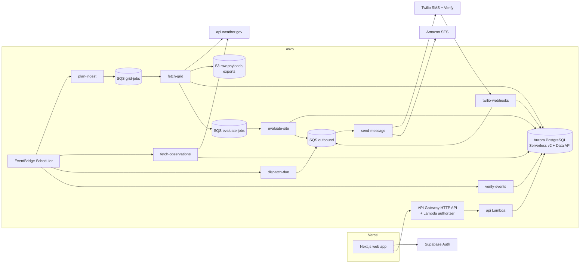

# InSite Weather: Technical Design

**Status:** Draft v0.1 · **Updated:** 2026-11-15 · **Implements:** [PRD.md](./PRD.md)

This document describes how the MVP is built. Decisions marked **Proposed** should be confirmed and then recorded as ADRs in `docs/adr/`.

## 1. Goals and non-goals

**Goals**
- Never miss an alert because of a system failure. Every stage is idempotent, retried and alarmed.
- Keep the alert logic (rules, event grouping, alert timing, reply parsing) in pure, well-tested TypeScript, separate from infrastructure.
- Store every input behind every alert decision, so each compliance record can be reproduced.
- Stay cheap at low volume: serverless everything, scale to zero in dev.

**Non-goals (MVP):** on-site station calibration, multi-site accounts, payments, a secondary forecast provider.

## 2. Architecture



### 2.1 Key decisions

| # | Decision | Choice | Status |
|---|---|---|---|
| D1 | Database | **Aurora PostgreSQL Serverless v2 with the RDS Data API.** Lambdas reach the database over HTTPS, so they don't need to run in a VPC (no NAT gateway cost). Dev clusters can scale to 0 ACUs and auto-pause. Prod keeps a minimum above 0 so alert jobs never wait for a resume. | Proposed |
| D2 | Web → data access | The web app never touches the database directly. It calls the AWS HTTP API with the user's Supabase access token. | Proposed |
| D3 | Token verification | Use Supabase asymmetric JWT signing keys and verify tokens in a Lambda authorizer with `jose` against the project's JWKS endpoint (`<issuer>/.well-known/jwks.json`). | Proposed |
| D4 | SMS | **Twilio** Programmable Messaging (a Messaging Service with built-in STOP/HELP opt-out handling), status callbacks, and **Twilio Verify** for the phone code. | Proposed |
| D5 | Email | **Amazon SES** (domain identity with DKIM). | Proposed |
| D6 | ORM / migrations | **Drizzle ORM** with its AWS Data API Postgres driver; `drizzle-kit` for migrations. | Proposed |
| D7 | Maps | **MapLibre GL JS** with a hosted tile and geocoding provider (MapTiler or Stadia; pick on price). | Proposed |
| D8 | Alert timing | Polling, not per-event timers: `dispatch-due` runs every 5 minutes and sends whatever is due. Simpler and self-healing after outages. | Proposed |
| D9 | Python / Modal | Not used in the MVP. Reserved for calibration statistics in the on-site station phase. | Accepted |
| D10 | Log-in identifier | Email + password in Supabase. The username is a display name/handle that the API resolves to an email at log-in if the PRD keeps username log-in. | Proposed |

## 3. Monorepo

pnpm workspaces + Turborepo, TypeScript project references, Vitest, ESLint + Prettier.

```
apps/web/                Next.js (App Router) on Vercel
services/                Lambda handlers (thin: parse input → call packages → write output)
  api/  plan-ingest/  fetch-grid/  fetch-observations/  evaluate-site/
  dispatch-due/  send-message/  twilio-webhooks/  verify-events/  authorizer/
packages/
  core/                  rules, event grouping, alert planning, reply parsing (pure, no I/O)
  weather/               NWS client, unit conversion, interval → hourly expansion
  messaging/             Twilio + SES adapters, message templates
  db/                    Drizzle schema, migrations, typed queries
  config/                shared tsconfig, eslint, env schema (zod)
infra/                   CDK app (stacks in §9)
python/                  reserved for Modal
docs/                    PRD, technical design, roadmap, ADRs
```

Rule: `packages/core` has no dependencies on AWS, Twilio or the database. Everything that decides *whether* and *when* to alert lives there and is unit-tested with recorded NWS fixtures.

## 4. Weather ingestion

### 4.1 NWS endpoints

| Use | Endpoint |
|---|---|
| Site → grid + stations (at sign-up, refreshed weekly) | `GET /points/{lat},{lon}` → `gridId`, `gridX`, `gridY`, `observationStations` URL |
| Raw forecast (about 7 days) | `GET /gridpoints/{wfo}/{x},{y}` (`forecastGridData`) |
| Observations | `GET /stations/{id}/observations?start=…` |

All requests send `User-Agent: (insiteweather.com, ops@insiteweather.com)` and `Accept: application/geo+json`. NWS data is free, open and needs no key.

**Gridpoint layers used:** `windSpeed`, `windGust`, `windDirection`, `quantitativePrecipitation`, `probabilityOfPrecipitation`, `relativeHumidity`, `temperature`, `maxTemperature`, `minTemperature`.

### 4.2 Pipeline

1. **`plan-ingest`** (hourly, EventBridge Scheduler): select distinct `(wfo, x, y)` for active sites and enqueue one message per grid cell to `grid-jobs`. Message deduplication ID: `wfo:x:y:<hour>`.
2. **`fetch-grid`** (SQS consumer, reserved concurrency 5 to stay polite to NWS): fetch the gridpoint, then
   - write the raw JSON to `s3://…/raw/gridpoints/{wfo}/{x},{y}/{fetchedAt}.json`;
   - skip the rest if `updateTime` is unchanged since the last pull;
   - normalize: expand each ISO-8601 interval value (e.g. `2026-11-15T18:00:00+00:00/PT3H`) into hourly rows and convert units to SI (m/s, mm, °C, %);
   - insert `forecast_pulls` + `forecast_hourly`; enqueue one `evaluate-jobs` message per site in that cell.
3. **`fetch-observations`** (hourly): fetch recent observations for each station in use; upsert `observations_hourly`.
4. **Daily summaries** (inside `fetch-observations`, once per station per local day after 02:00 local): compute the previous day's min/max/mean RH, max/min temperature, total precipitation, max sustained wind, peak gust and direction into `observations_daily`. Days with less than 75% hourly coverage are flagged `incomplete`.

Retries: SQS redrive after 3 attempts to a DLQ (alarmed). Gridpoint 5xx errors are common and retried with jittered backoff inside the Lambda first.

**Freshness:** `fetch-grid` publishes a CloudWatch metric `ForecastAgeMinutes` per grid cell. An alarm fires if any active cell is older than 180 minutes.

## 5. Rules engine (`packages/core`)

### 5.1 Rule format

Rules are versioned JSON stored in the `rules` table and seeded from `packages/core/rules/*.json`.

```ts
type Metric = 'windSpeed' | 'windGust' | 'rh' | 'pop' | 'precip';

type Condition =
  | { metric: Exclude<Metric, 'precip'>; op: '>=' | '<='; value: number }          // at the hour
  | { metric: 'precip'; window: { hours: number; side: 'before' | 'around' };       // rolling sum
      op: '>=' | '<'; value: number };

interface Rule {
  concern: 'dust' | 'stormwater' | 'trackout';
  tier: 'moderate' | 'high';
  version: number;
  all: Condition[];      // every condition must hold
  any?: Condition[];     // and at least one of these (e.g. wind OR gust)
}
```

Example: dust / high (PRD §6.2):

```json
{ "concern": "dust", "tier": "high", "version": 1,
  "all": [ { "metric": "rh", "op": "<=", "value": 35 },
           { "metric": "precip", "window": { "hours": 48, "side": "before" }, "op": "<", "value": 2.54 } ],
  "any": [ { "metric": "windSpeed", "op": ">=", "value": 8.94 },
           { "metric": "windGust",  "op": ">=", "value": 13.41 } ] }
```

Values are stored in SI units (8.94 m/s = 20 mph; 2.54 mm = 0.10 in).

### 5.2 Evaluation

```ts
evaluateSite(input: {
  series: HourlyPoint[];   // observed past 48 h + forecast next 120 h, hourly, SI units
  rules: Rule[];           // for this concern
  sensitivity: 'standard' | 'cautious';
}): CandidateWindow[]
```

1. For each forecast hour, compute the highest tier whose rule holds. Precipitation windows look back into observed hours, so "dry for 48 h" uses real rainfall.
2. Drop hours below the site's alerting tier (`standard` → high only; `cautious` → moderate and high).
3. Merge qualifying hours into windows when the gap is ≤ 6 h.
4. Output `{ start, end, peakTier, peakValues }` per window.

### 5.3 Matching windows to events

On every evaluation, candidate windows are reconciled with the site's open events for that concern:

- **Overlaps an open event** → update the event's window, tier and trigger values (`events.revision += 1`, previous values kept in `event_revisions`).
- **No overlap** → create a new event.
- **Open event with no candidate** and its start is still in the future → mark `cancelled`.

Event IDs are human-readable per concern, e.g. `D-1042` and `S-0311`, so they read well in texts and records.

## 6. Alert planning and dispatch

### 6.1 Planning (pure function)

```ts
planAlerts(event: Event, site: Site, sent: SentMessage[], now: Date): PlannedMessage[]
```

| Message | Due time (site local) | Condition |
|---|---|---|
| `heads_up` | `start − 72h` (or now, if detected later) | Not weekend rule; start > now + 24h |
| `action` | `start − 24h` (or now, if detected later) | Still open at alerting tier |
| `action` (weekend rule) | Instead of heads-up: Friday 2 pm before a Sat/Sun event, or `start − 72h` if later | Event starts on Sat/Sun |
| `reminder` | `start − 6h` | Action sent, no reply |
| `escalation` | now | Tier rose to high after a heads-up |
| `cancel` | now | Cancelled after any alert was sent |

Quiet hours (20:00–06:00 local) push the due time to 06:00, unless that is less than 2 h before the event start, in which case the message moves back to 19:59 the previous evening.

### 6.2 Dispatch

- **`dispatch-due`** runs every 5 minutes. It loads open events with a due message, calls `planAlerts`, and enqueues to `outbound`.
- **`send-message`** does `INSERT INTO messages … ON CONFLICT (event_id, type) DO NOTHING RETURNING id`. If no row comes back, the message is already sent and the job is dropped. This is the exactly-once guard. It then renders the template, calls Twilio with a `StatusCallback` URL, and stores the `MessageSid`.
- Twilio status callbacks update `messages.status`. On `failed` / `undelivered`: retry once after 5 minutes, then send the email copy and raise an ops alarm.
- Users who have opted out (`users.sms_opted_out_at`) get email only.

Templates live in `packages/messaging/templates.ts`. A unit test renders every template with worst-case values and asserts GSM-7 encoding and ≤ 306 characters.

## 7. Inbound SMS

`POST /webhooks/twilio/inbound` (API Gateway → `twilio-webhooks` Lambda):

1. Validate `X-Twilio-Signature`; reject otherwise.
2. Store the raw message in `inbound_messages` (always, even if unmatched).
3. Look up the user by `From` (E.164). Unknown number → "not recognized" reply.
4. `parseReply(body)` (pure): normalize case and punctuation, take the first word as the keyword and the rest as the note. Recognized keywords: `WATERED`, `SWEPT`, `DONE`, `NOTNEEDED`, `RECORDS`, `HELP`. STOP/START are handled by Twilio Advanced Opt-Out; the webhook only mirrors the opt-out state into `users`.
5. `matchReply(keyword, openEvents)` (pure): map the keyword to concerns, pick the soonest matching open event, and return the event or an ambiguity/no-match result.
6. In one transaction: insert `responses`, set the event to `acknowledged`, insert a `compliance_entries` row; then enqueue a confirmation.

Reply with TwiML only for errors. Confirmations go through `outbound`, so they are logged like every other message.

## 8. Data model

PostgreSQL, all timestamps `timestamptz` (UTC). Abbreviated DDL:

```sql
create table users (
  id uuid primary key,                       -- Supabase auth user id
  email text not null unique, username text unique,
  phone_e164 text not null unique, phone_verified_at timestamptz,
  sms_consent_at timestamptz, sms_consent_text_version text, sms_consent_ip inet,
  sms_opted_out_at timestamptz, created_at timestamptz default now()
);

create table sites (
  id uuid primary key, user_id uuid references users not null,
  name text not null, address text, lat double precision not null, lon double precision not null,
  timezone text not null, nws_wfo text, nws_x int, nws_y int, station_ids text[],
  operating_days smallint[] default '{1,2,3,4,5}', status text default 'active',
  created_at timestamptz default now()
);

create table site_concerns (
  site_id uuid references sites, concern text, sensitivity text default 'cautious',
  active boolean default true, primary key (site_id, concern)
);

create table rules (concern text, tier text, version int, definition jsonb not null,
  effective_from timestamptz not null, primary key (concern, tier, version));

create table forecast_pulls (id bigserial primary key, wfo text, x int, y int,
  nws_update_time timestamptz, fetched_at timestamptz, s3_key text);
create table forecast_hourly (pull_id bigint references forecast_pulls, valid_at timestamptz,
  wind_speed real, wind_gust real, wind_dir real, precip real, pop real, rh real,
  temp real, temp_max real, temp_min real, primary key (pull_id, valid_at));

create table observations_hourly (station_id text, observed_at timestamptz,
  wind_speed real, wind_gust real, wind_dir real, precip real, rh real, temp real,
  primary key (station_id, observed_at));
create table observations_daily (station_id text, local_date date, metrics jsonb not null,
  complete boolean, primary key (station_id, local_date));

create table events (
  id uuid primary key, code text unique not null, site_id uuid references sites,
  concern text, window_start timestamptz, window_end timestamptz, peak_tier text,
  status text,               -- forecasted|heads_up_sent|action_sent|acknowledged|no_action|cancelled
  trigger_values jsonb, rule_version int, forecast_pull_id bigint, revision int default 1,
  outcome text, outcome_values jsonb,   -- observed|not_observed|indeterminate
  created_at timestamptz default now(), updated_at timestamptz default now()
);
create table event_revisions (event_id uuid references events, revision int,
  snapshot jsonb, created_at timestamptz default now(), primary key (event_id, revision));

create table messages (
  id uuid primary key, event_id uuid references events, user_id uuid references users,
  channel text, type text, body text, provider_id text, status text,
  sent_at timestamptz, delivered_at timestamptz,
  unique (event_id, type, channel)         -- exactly-once guard
);

create table inbound_messages (id uuid primary key, from_e164 text, body text,
  provider_id text unique, received_at timestamptz, user_id uuid, parsed jsonb);
create table responses (id uuid primary key, event_id uuid references events,
  inbound_id uuid references inbound_messages, keyword text, note text, received_at timestamptz);

create table compliance_entries (     -- append-only: no UPDATE/DELETE grants for the app role
  id uuid primary key, site_id uuid references sites, event_id uuid references events,
  entry_type text, payload jsonb not null, supersedes_id uuid references compliance_entries,
  created_at timestamptz default now()
);
```

Append-only is enforced by database grants: the application role has only `INSERT, SELECT` on `compliance_entries`.

## 9. API

API Gateway HTTP API. All `/v1/*` routes go through the Supabase JWT authorizer, except onboarding routes, which use a signed onboarding token (an HMAC'd onboarding ID in an `httpOnly` cookie).

| Method & path | Purpose |
|---|---|
| `POST /v1/onboarding` | Address, concerns, phone, email, consent → onboarding ID + geocode result |
| `PUT /v1/onboarding/{id}/location` | Confirmed lat/lon → resolve NWS grid + stations |
| `POST /v1/onboarding/{id}/verify` | Send Twilio Verify code |
| `POST /v1/onboarding/{id}/verify/check` | Check the code |
| `POST /v1/onboarding/{id}/complete` | Username + password → create Supabase user (admin API, server-side), create user/site rows, send welcome |
| `GET /v1/me` | Profile + sites |
| `PATCH /v1/sites/{id}` | Name, pin, concerns, sensitivity, operating days, pause |
| `GET /v1/sites/{id}/outlook` | 5-day risk by concern (for the dashboard) |
| `GET /v1/sites/{id}/weather` | Hourly series + nearest station for the map |
| `GET /v1/sites/{id}/records?from&to&format=json\|csv\|pdf` | Compliance records; PDF/CSV returned as a presigned S3 URL |
| `POST /webhooks/twilio/inbound`, `/status` | Twilio (signature-verified) |

Every handler checks that `site.user_id = token.sub`. Validation uses zod schemas shared with the web app from `packages/core`.

**Records PDF:** generated in Lambda with `@react-pdf/renderer`, stored at `s3://…/exports/{userId}/…`, served by a 15-minute presigned URL. `RECORDS` texts link to `/records` (log-in required).

## 10. Web app (`apps/web`)

- Next.js App Router on Vercel, using the `@supabase/ssr` client for sessions.
- Pages: `/` (landing + start onboarding), `/start/*` (onboarding steps), `/login`, `/dashboard`, `/records`, `/settings`.
- Map: MapLibre with the site pin (draggable during onboarding). The weather layer draws hourly wind arrows and precipitation from `/weather`, with a time slider. A NOAA radar layer is optional later.
- Mobile-first with large touch targets. Components are tested with Testing Library; the onboarding flow is tested end to end with Playwright against a dev stack.

## 11. Infrastructure (CDK)

| Stack | Resources |
|---|---|
| `DataStack` | VPC (isolated subnets only, for Aurora), Aurora Serverless v2 cluster with Data API enabled, Secrets Manager credentials, S3 buckets (raw, exports; KMS, versioning, lifecycle rules) |
| `PipelineStack` | Ingest/evaluate/dispatch/verify Lambdas, SQS queues + DLQs, EventBridge Scheduler schedules |
| `ApiStack` | HTTP API, authorizer Lambda, api Lambda, Twilio webhook routes, custom domain `api.insiteweather.com` |
| `MessagingStack` | SES domain identity + DKIM, Twilio credentials in Secrets Manager |
| `ObservabilityStack` | CloudWatch dashboard, alarms → SNS → ops email/SMS |

**Environments:** `dev` and `prod` in separate AWS accounts. Each has its own Supabase project, Twilio subaccount and Vercel environment.

**CI/CD (GitHub Actions):**
- On PR: install, lint, typecheck, unit tests, `cdk synth`, Vercel preview.
- On merge to `main`: run migrations and `cdk deploy` to dev.
- On release tag: manual approval, then deploy to prod.
- AWS access via GitHub OIDC (no long-lived keys).

## 12. Observability

| Alarm | Threshold |
|---|---|
| Forecast freshness (any active grid cell) | > 180 min |
| `dispatch-due` heartbeat missing | No successful run in 20 min |
| Any DLQ depth | > 0 |
| SMS failure rate | > 2% over 1 h |
| Lambda errors (any pipeline function) | > 0 for 3 consecutive periods |
| Unmatched inbound replies | > 5 per day (signals copy or parsing problems) |

Logs are structured JSON (Powertools for AWS Lambda) with `siteId`, `eventId` and `messageId` on every line.

## 13. Security and privacy

- Secrets (Twilio, Supabase service role key, SES) live in Secrets Manager and are only readable by the functions that need them.
- Aurora and S3 are encrypted at rest with KMS. Raw NWS data holds no personal data; exports are per-user prefixes.
- Webhooks use Twilio signature validation. The API is rate-limited per IP at API Gateway, with tighter limits on onboarding and verify routes.
- Phone numbers are stored in E.164 format. Logs mask them to the last 4 digits.
- Consent records store the timestamp, IP and consent text version for SMS registration and TCPA purposes.

## 14. Testing

| Layer | Approach |
|---|---|
| `packages/core` | Unit tests (target 95%+ coverage) for rules, grouping, reconciliation, `planAlerts` (weekend, quiet hours, late detection), `parseReply` / `matchReply` |
| `packages/weather` | Fixtures recorded from real NWS responses (several regions and seasons); interval expansion and unit conversion tests |
| Backtesting | `pnpm backtest --site <lat,lon> --from --to` replays historical observations against the rules and reports events per week, precision and recall. Used to tune thresholds before the pilot |
| Integration | Pipeline Lambdas against a dev stack, with Twilio test credentials and magic numbers |
| End to end | Playwright onboarding → simulated forecast → alert → reply → record |

## 15. Delivery plan

Maps to the PRD milestones:

1. **Phase 0:** monorepo scaffold, CI, CDK `DataStack` + `ObservabilityStack`, Supabase + Vercel projects, Twilio toll-free verification or 10DLC registration started.
2. **Phase 1:** `packages/weather`, `packages/core` rules + evaluation, ingest pipeline, backtest CLI.
3. **Phase 2:** `packages/messaging`, dispatch, send, inbound webhooks.
4. **Phase 3:** web app, API, records export.

## 16. Open technical questions

1. Prod Aurora minimum capacity (0.5 ACU vs. higher) after measuring load.
2. Toll-free verification or 10DLC for the sending number?
3. MapTiler vs. Stadia for tiles and geocoding (cost at expected volume).
4. Use the computed daily summaries only, or cross-check against NOAA climate data (NCEI/ACIS) when it becomes available?
5. Should evaluation also run immediately when observations change materially (e.g., an unexpected rain gauge reading), or is hourly enough?
