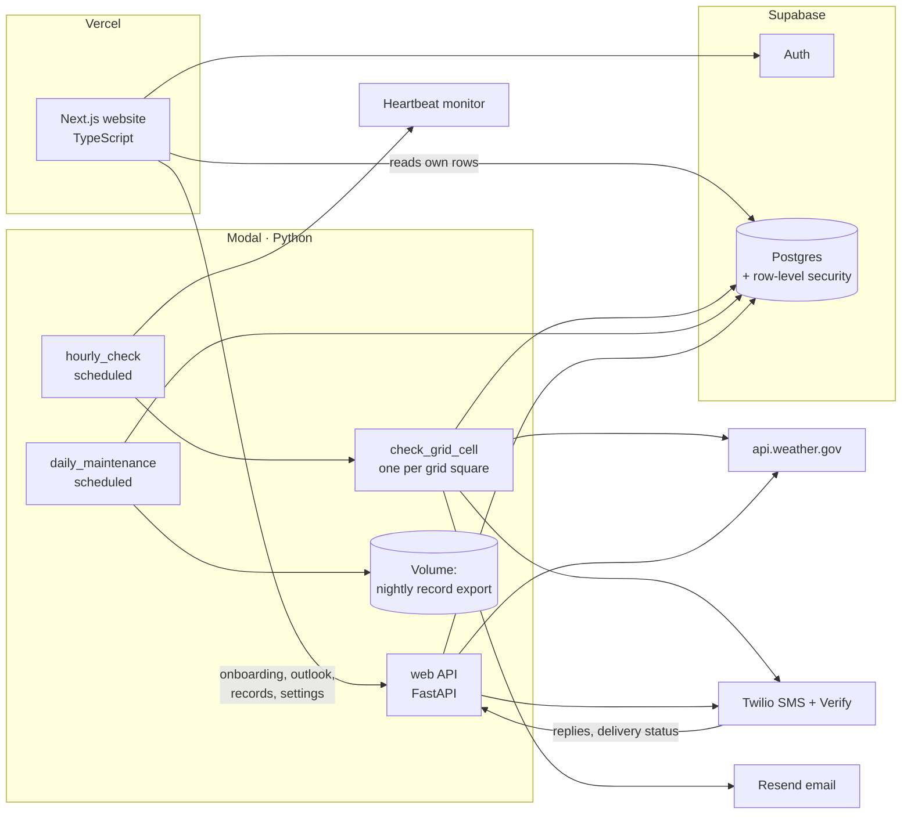

# InSite Weather: Technical Design

**Status:** Draft v0.2 · **Updated:** 2026-11-19 · **Implements:** [PRD.md](./PRD.md)

This document describes how the MVP is built. Decisions marked **Proposed** should be confirmed and then recorded as ADRs in `docs/adr/`.

**Changes in v0.2:** AWS removed. The back end is Python on **Modal**; **Supabase** provides the database and authentication; the six-stage ingestion pipeline is replaced by **one hourly check**; the website fetches weather on demand; no weather history is stored.

## 1. Goals and non-goals

**Goals**
- Never miss an alert because of a system failure. The hourly check is idempotent, retried, and watched by an external heartbeat.
- Keep the alert logic (rules, event grouping, alert timing, reply parsing) in pure, well-tested Python, separate from I/O.
- Store state, not weather. Keep the inputs behind every alert that was sent, so its compliance record can be reproduced; don't keep weather history behind decisions *not* to alert (§8.1).
- Keep the moving parts few: one scheduled job, one daily maintenance job, one web API.

**Non-goals (MVP):** on-site station calibration, multi-site accounts, payments, a secondary forecast provider.

## 2. Architecture



### 2.1 Key decisions

| # | Decision | Choice | Status |
|---|---|---|---|
| D1 | Database | **Supabase Postgres** (same project as Auth). Row-level security (RLS) lets the website read a user's own rows directly. | Accepted |
| D2 | Back end | **Python 3.12 on Modal**: scheduled functions, built-in retries, and one FastAPI web app. Modal functions can only be defined in Python; the website stays TypeScript. | Accepted |
| D3 | Ingestion | **One hourly check** that fetches, evaluates, sends and forgets. No ingestion pipeline, queues or weather tables. | Accepted |
| D4 | Website data access | Reads go straight to Supabase under RLS. **All writes and anything touching NWS, Twilio or the rules go through the Modal API.** | Proposed |
| D5 | Token verification | The Modal API verifies Supabase access tokens with PyJWT against the project's JWKS endpoint (`<issuer>/.well-known/jwks.json`), using Supabase's asymmetric signing keys. | Proposed |
| D6 | SMS | **Twilio** Programmable Messaging (Messaging Service with built-in STOP/HELP handling), status callbacks, and **Twilio Verify** for the sign-up code. Texts come from one **verified toll-free (8XX) number**: Twilio reviews verification within about 3 business days, with no brand or campaign registration and no monthly campaign fee. Chosen over 10DLC, whose reviews currently take 1–3 weeks. | Accepted |
| D7 | Email | **Resend**, also configured as Supabase Auth's custom SMTP. | Proposed |
| D8 | Database access from Python | **psycopg 3** through Supabase's connection pooler (real transactions for the reply flow), with SQL kept in `insite/db/`. Schema managed by **Supabase CLI migrations**. | Proposed |
| D9 | Maps | **MapLibre GL JS** with a hosted tile and geocoding provider (MapTiler or Stadia; pick on price). | Proposed |
| D10 | Log-in identifier | Email + password in Supabase. A username, if the PRD keeps it, is resolved to the email by the API at log-in. | Proposed |

## 3. Repository layout

```
apps/web/                Next.js (App Router) on Vercel · TypeScript, pnpm
backend/                 Python project (uv), deployed to Modal
  insite/core/           rules, event grouping, alert planning, reply parsing (pure, no I/O)
  insite/weather/        NWS client, unit conversion, interval → hourly expansion
  insite/messaging/      Twilio + Resend adapters, message templates
  insite/db/             SQL queries and transactions
  insite/api/            FastAPI app: onboarding, outlook, records, settings, Twilio webhooks
  insite/jobs/           hourly_check, check_grid_cell, daily_maintenance
  modal_app.py           Modal app: images, secrets, schedules, web endpoint
  tests/
supabase/                migrations, RLS policies, seed data, config
docs/                    PRD, technical design, roadmap, ADRs
```

Tooling: `uv`, `ruff`, `mypy` and `pytest` for Python; `pnpm`, ESLint and Vitest for the website. Website types are generated from the database with `supabase gen types`.

Rule: `insite/core` imports nothing that does I/O. Everything that decides *whether* and *when* to alert lives there and is tested with recorded NWS fixtures.

## 4. Weather data

### 4.1 NWS endpoints

| Use | Endpoint |
|---|---|
| Site → grid square + nearby stations (at sign-up and when the pin moves) | `GET /points/{lat},{lon}` → `gridId`, `gridX`, `gridY`, `observationStations` |
| Forecast, about 7 days, hourly-or-coarser intervals | `GET /gridpoints/{wfo}/{x},{y}` (raw grid data) |
| Station readings | `GET /stations/{id}/observations?start=…` |

All requests send `User-Agent: (insiteweather.com, ops@insiteweather.com)`. Gridpoint requests send `If-Modified-Since` with the stored `Last-Modified` value, so an unchanged forecast costs one empty response.

**Gridpoint layers used:** `windSpeed`, `windGust`, `windDirection`, `quantitativePrecipitation`, `probabilityOfPrecipitation`, `relativeHumidity`, `temperature`, `maxTemperature`, `minTemperature`. Interval values (e.g. `2026-11-15T18:00:00+00:00/PT3H`) are expanded to hourly points and converted to SI units in `insite/weather`.

### 4.2 What is stored

Only one row per grid square in use (`grid_cells`): its `Last-Modified` time and the **latest** parsed forecast, overwritten each time it changes. This row is a cache, not history. It lets the hourly check skip unchanged forecasts and lets the dashboard show the outlook without waiting on the NWS.

Station readings are never stored. They are fetched when needed: the last 48 hours for the "has it been dry?" part of the dust rule, and an event's window when checking its outcome.

**Pilot only:** with `ARCHIVE_FORECASTS=true`, each changed forecast is also appended to `forecast_archive` for threshold tuning. This is switched off and the table emptied when the pilot ends (§8.1).

## 5. The hourly check

```python
@app.function(schedule=modal.Cron("7 * * * *"), timeout=900)
def hourly_check(): ...

@app.function(retries=modal.Retries(max_retries=3, initial_delay=30.0), timeout=300)
def check_grid_cell(cell_id: str): ...
```

1. **`hourly_check`** lists grid squares that have at least one active site and runs `check_grid_cell.map(cells)`, one call per square. When every call has finished, it pings the heartbeat monitor. A square that still fails after its retries is logged and reported, but doesn't block the others.
2. **`check_grid_cell`**:
   1. Conditional GET of the gridpoint forecast. On `304 Not Modified`, use the cached forecast from `grid_cells`.
   2. For each site in the square: fetch the last 48 h of station readings (cached in memory per station for this run).
   3. Run the rules (§6) for each active concern and reconcile the results with the site's open events.
   4. Plan due messages (§7) and send them.
   5. Verify events that ended 6–72 hours ago and have no outcome yet: fetch the station readings for the window, record observed / not observed / indeterminate, and add a `verified` compliance entry for alerted events.
3. The run is **self-healing**: every run recomputes from the current forecast and the current time. A failed or skipped run is caught up by the next one, and a one-hour delay is harmless for 72-, 24- and 6-hour warnings.

**Scheduled at minute 7** to stay off the top of the hour. The NWS asks clients not to request the same point more than about twice an hour; hourly is well inside that.

**Daily maintenance** (`daily_maintenance`, `modal.Cron("30 1 * * *", timezone="America/Los_Angeles")`):
- Accuracy roll-up: for each site and concern, compare the previous day's station readings with the rules and write `accuracy_daily` (alerted and observed, alerted and not observed, missed, indeterminate).
- Purge per §8.1.
- Export compliance tables (gzipped JSON Lines) to a Modal Volume, as a second copy outside Supabase.

## 6. Rules engine (`insite/core`)

### 6.1 Rule format

Rules are versioned JSON in the `rules` table, seeded from `backend/insite/core/rules/*.json` and loaded into typed models (Pydantic).

```python
Metric = Literal["windSpeed", "windGust", "rh", "pop", "precip"]

class Condition(BaseModel):
    metric: Metric
    op: Literal[">=", "<=", "<"]
    value: float
    window: PrecipWindow | None = None   # precip only: rolling sum over N hours before/around

class Rule(BaseModel):
    concern: Literal["dust", "stormwater", "trackout"]
    tier: Literal["moderate", "high"]
    version: int
    all: list[Condition]                 # every condition must hold
    any: list[Condition] = []            # and at least one of these (e.g. wind OR gust)
```

Example: dust / high (PRD §6.2), values in SI units (8.94 m/s = 20 mph; 2.54 mm = 0.10 in):

```json
{ "concern": "dust", "tier": "high", "version": 1,
  "all": [ { "metric": "rh", "op": "<=", "value": 35 },
           { "metric": "precip", "window": { "hours": 48, "side": "before" }, "op": "<", "value": 2.54 } ],
  "any": [ { "metric": "windSpeed", "op": ">=", "value": 8.94 },
           { "metric": "windGust",  "op": ">=", "value": 13.41 } ] }
```

### 6.2 Evaluation

```python
def evaluate(series: list[HourlyPoint], rules: list[Rule],
             sensitivity: Literal["standard", "cautious"]) -> list[CandidateWindow]: ...
```

`series` = observed past 48 h + forecast next 120 h, hourly, SI units.

1. For each forecast hour, find the highest tier whose rule holds. Precipitation windows look back into observed hours, so "dry for 48 h" uses real rainfall.
2. Drop hours below the site's alerting tier (`standard` → high only; `cautious` → moderate and high).
3. Merge qualifying hours into windows when the gap is ≤ 6 h.
4. Return `start`, `end`, `peak_tier` and `peak_values` per window.

The same function serves the dashboard's 5-day outlook (§9), so alerts and the outlook can never disagree.

### 6.3 Matching windows to events

- **Overlaps an open event** → update its window, tier and trigger values (`revision += 1`; the previous values go to `event_revisions`).
- **No overlap** → create a new event.
- **Open event with no matching window** and a start still in the future → mark `cancelled`.

Event codes are readable per concern, e.g. `D-1042` and `S-0311`.

## 7. Alerts

### 7.1 Planning (pure function)

```python
def plan_alerts(event: Event, site: Site, sent: list[SentMessage], now: datetime) -> list[PlannedMessage]: ...
```

| Message | Due (site local time) | Condition |
|---|---|---|
| `heads_up` | `start − 72h` (or now, if detected later) | Not weekend rule; start > now + 24h |
| `action` | `start − 24h` (or now, if detected later) | Still open at alerting tier |
| `action` (weekend rule) | Instead of heads-up: Friday 2 pm before a Sat/Sun event, or `start − 72h` if later | Event starts on Sat/Sun |
| `reminder` | `start − 6h` | Action sent, no reply |
| `escalation` | now | Tier rose to high after a heads-up |
| `cancel` | now | Cancelled after any alert was sent |

A message is sent by the first hourly run at or after its due time. Quiet hours (20:00–06:00 local) push it to 06:00, unless that is less than 2 h before the event starts; then it goes at the last run before 20:00.

### 7.2 Sending

- **Exactly once:** `INSERT INTO messages … ON CONFLICT (event_id, type, channel) DO NOTHING RETURNING id` before calling Twilio. No row back means it was already sent. A retried `check_grid_cell` therefore never double-texts.
- Twilio is called with a `StatusCallback` URL; delivery status updates `messages.status`. A `failed` or `undelivered` text is retried once by the next hourly run, then the email copy goes out and ops is notified.
- Users who texted STOP (`profiles.sms_opted_out_at`) get email only.
- When the **first** message for an event is sent, an `alert_opened` compliance entry stores a copy of everything the decision used: trigger values, forecast grid and NWS issue time, rule version and definition, and the site's sensitivity. Records never depend on weather data that isn't kept.

Templates live in `insite/messaging/templates.py`. A test renders every template with worst-case values and asserts GSM-7 encoding and ≤ 306 characters.

## 8. Data model

Supabase Postgres, all timestamps `timestamptz` (UTC). Abbreviated DDL:

```sql
create table profiles (                      -- one per Supabase auth user
  id uuid primary key references auth.users on delete restrict,
  username text unique, phone_e164 text not null unique, phone_verified_at timestamptz,
  sms_consent_at timestamptz, sms_consent_text_version text, sms_consent_ip inet,
  sms_opted_out_at timestamptz, created_at timestamptz default now()
);

create table grid_cells (                    -- cache: latest forecast only, overwritten
  id text primary key,                       -- e.g. 'MTR/85,105'
  last_modified timestamptz, forecast jsonb, fetched_at timestamptz
);

create table sites (
  id uuid primary key, user_id uuid not null references profiles,
  name text not null, address text, lat double precision not null, lon double precision not null,
  timezone text not null, grid_cell_id text references grid_cells, station_ids text[],
  operating_days smallint[] default '{1,2,3,4,5}', status text default 'active',
  created_at timestamptz default now()
);

create table site_concerns (
  site_id uuid references sites, concern text, sensitivity text default 'cautious',
  active boolean default true, primary key (site_id, concern)
);

create table rules (concern text, tier text, version int, definition jsonb not null,
  effective_from timestamptz not null, primary key (concern, tier, version));

create table events (
  id uuid primary key, code text unique not null, site_id uuid references sites,
  concern text, window_start timestamptz, window_end timestamptz, peak_tier text,
  status text,               -- forecasted|heads_up_sent|action_sent|acknowledged|no_action|cancelled
  trigger_values jsonb, rule_version int, forecast_issued_at timestamptz, revision int default 1,
  outcome text, outcome_values jsonb,        -- observed|not_observed|indeterminate
  created_at timestamptz default now(), updated_at timestamptz default now()
);
create table event_revisions (event_id uuid references events on delete cascade, revision int,
  snapshot jsonb, created_at timestamptz default now(), primary key (event_id, revision));

create table messages (
  id uuid primary key, event_id uuid references events, user_id uuid references profiles,
  channel text, type text, body text, provider_id text, status text,
  sent_at timestamptz, delivered_at timestamptz,
  unique (event_id, type, channel)           -- exactly-once guard
);

create table inbound_messages (id uuid primary key, from_e164 text, body text,
  provider_id text unique, received_at timestamptz, user_id uuid, parsed jsonb);
create table responses (id uuid primary key, event_id uuid references events,
  inbound_id uuid references inbound_messages, keyword text, note text, received_at timestamptz);

create table compliance_entries (            -- alerted events only; append-only
  id uuid primary key, site_id uuid references sites, event_id uuid references events,
  entry_type text, payload jsonb not null, supersedes_id uuid references compliance_entries,
  created_at timestamptz default now()
);

create table accuracy_daily (site_id uuid references sites, concern text, local_date date,
  alerted_observed int, alerted_not_observed int, missed int, indeterminate int,
  primary key (site_id, concern, local_date));

create table forecast_archive (              -- pilot only (ARCHIVE_FORECASTS)
  grid_cell_id text, nws_issued_at timestamptz, forecast jsonb, primary key (grid_cell_id, nws_issued_at));
```

**Row-level security:** enabled on every table. Signed-in users may `SELECT` their own `profiles`, `sites`, `site_concerns`, `events`, `messages`, `responses` and `compliance_entries` (joined through `sites.user_id = auth.uid()`). They have no `INSERT`, `UPDATE` or `DELETE` rights; all writes come from the Modal back end using a dedicated database role.

**Append-only records:** the back-end role has only `INSERT, SELECT` on `compliance_entries`; corrections are new rows that point at the original via `supersedes_id`.

### 8.1 Data retention

| Data | Pilot | After the pilot | Mechanism |
|---|---|---|---|
| Latest forecast per grid square (`grid_cells`) | Overwritten hourly | Overwritten hourly | No history kept |
| Forecast history (`forecast_archive`) | Kept for tuning | Not collected; table emptied | `ARCHIVE_FORECASTS` flag |
| Station readings | Not stored | Not stored | Fetched when needed |
| Events that never produced a message (and revisions) | Kept | Deleted 5 days after the window ends | `daily_maintenance` |
| Alerted events, their messages, replies and compliance entries | Permanent | Permanent | Never purged; append-only |
| Alert accuracy | Daily counts | Daily counts | `accuracy_daily` |

This keeps less than the 5-day limit allows: after the pilot, no raw weather history exists at all.

### 8.2 Backups

Supabase Pro includes daily backups kept for 7 days. Because compliance records are permanent, `daily_maintenance` also writes a gzipped export of `compliance_entries`, `events` (alerted), `messages` and `responses` to a Modal Volume. That is a second copy with a different provider. Point-in-time recovery is not used during the pilot.

## 9. Web API (Modal, FastAPI)

One ASGI app deployed with `@modal.asgi_app()` at `api.insiteweather.com`. Routes under `/v1` require a Supabase access token (verified per D5), except onboarding routes, which use a signed, short-lived onboarding token in an `httpOnly` cookie.

| Method & path | Purpose |
|---|---|
| `POST /v1/onboarding` | Address, concerns, phone, email, consent → onboarding ID + geocode result |
| `PUT /v1/onboarding/{id}/location` | Confirmed lat/lon → NWS grid square + stations |
| `POST /v1/onboarding/{id}/verify` | Send Twilio Verify code |
| `POST /v1/onboarding/{id}/verify/check` | Check the code |
| `POST /v1/onboarding/{id}/complete` | Username + password → create Supabase user (admin API), profile and site; send welcome |
| `PATCH /v1/sites/{id}` | Name, pin (re-resolves grid square), concerns, sensitivity, operating days, pause |
| `PUT /v1/me/contact` | Change phone or email (re-verification required) |
| `GET /v1/sites/{id}/outlook` | 5-day risk by concern: cached forecast + rules (§6.2), computed on request |
| `GET /v1/sites/{id}/weather` | Hourly forecast series + nearest station, for the map |
| `GET /v1/sites/{id}/records?from&to&format=csv\|pdf` | Compliance records, generated on request and streamed back (nothing stored) |
| `POST /twilio/inbound`, `POST /twilio/status` | Twilio webhooks (signature-verified) |

**Inbound replies** (`/twilio/inbound`):
1. Validate `X-Twilio-Signature`; reject otherwise.
2. Store the raw message in `inbound_messages`, even if unmatched.
3. Look up the user by `From`. Unknown number → "not recognized" reply.
4. `parse_reply(body)` (pure): first word = keyword, rest = note. Keywords: `WATERED`, `SWEPT`, `DONE`, `NOTNEEDED`, `RECORDS`, `HELP`. STOP/START are handled by Twilio; the webhook mirrors opt-out state into `profiles`.
5. `match_reply(keyword, open_events)` (pure): map keyword to concerns and pick the soonest matching open event, or return an ambiguity/no-match result.
6. In one transaction: insert `responses`, mark the event `acknowledged`, insert a compliance entry, insert the confirmation `messages` row; then send the confirmation.

**Records PDF:** generated in Python (WeasyPrint from an HTML template). Every PDF carries the PRD's disclaimer.

## 10. Website (`apps/web`)

- Next.js App Router on Vercel; sessions via `@supabase/ssr`.
- Pages: `/` (landing + start onboarding), `/start/*` (onboarding steps), `/login`, `/dashboard`, `/records`, `/settings`.
- Reads (sites, events, records list) go straight to Supabase under RLS. The outlook, map data, record downloads and every change go through the Modal API.
- Map: MapLibre with the site pin (draggable during onboarding); wind arrows and precipitation from `/weather`, with a time slider.
- Mobile-first with large touch targets. Playwright covers the onboarding flow end to end against the dev environment.

## 11. Environments and deployment

| | dev | prod |
|---|---|---|
| Supabase | Own project | Own project |
| Modal | `dev` environment | `prod` environment |
| Vercel | Preview deployments | Production |
| Twilio | Test credentials and magic numbers; team phones only | Verified toll-free number |

**CI/CD (GitHub Actions):**
- On pull request: `ruff`, `mypy`, `pytest`; website lint, typecheck and tests; Vercel preview.
- On merge to `main`: `supabase db push` and `modal deploy` to dev.
- On release tag: manual approval, then the same against prod.

Secrets (Twilio, Supabase service key and database URL, Resend, heartbeat URL) live in **Modal Secrets** for the back end and Vercel environment variables for the website (public Supabase keys only).

## 12. Monitoring

| Check | Fires when | Where |
|---|---|---|
| Heartbeat | `hourly_check` hasn't checked in for 75 minutes | External heartbeat monitor → ops email/SMS |
| Stale forecast | Any active grid square's `fetched_at` older than 3 h | `system_health` view, checked by `hourly_check` |
| Grid square failing | A `check_grid_cell` call fails after all retries | Reported by `hourly_check` |
| Text failures | > 2% of texts failed in the last hour | `system_health` view |
| Unrecognized replies | > 5 per day | `system_health` view |

`hourly_check` reads `system_health` at the end of each run and emails ops about anything outside its threshold. The external heartbeat covers the case where Modal or the job itself isn't running at all. Logs are structured JSON with `site_id`, `event_id` and `message_id`, viewable in the Modal dashboard.

## 13. Security and privacy

- RLS on every table; the website only ever holds the user's own token and the public Supabase key.
- The Supabase service key and database credentials exist only in Modal Secrets.
- Twilio webhooks are signature-checked; onboarding and verify routes are rate-limited per IP.
- Phone numbers are stored in E.164 format and masked to the last 4 digits in logs.
- Consent records store the timestamp, IP and consent text version for toll-free verification and TCPA purposes.

## 14. Testing

| Layer | Approach |
|---|---|
| `insite/core` | Unit tests (95%+ coverage target) for rules, window merging, event reconciliation, `plan_alerts` (weekend, quiet hours, late detection, hourly granularity), `parse_reply` / `match_reply`; property-based tests with Hypothesis for timing edge cases |
| `insite/weather` | Recorded NWS responses from several regions and seasons; interval expansion, unit conversion, `304` handling |
| Backtesting | `uv run backtest --site <lat,lon> --from --to` replays historical weather from NOAA's public archives through the rules and reports alerts per week, precision and recall. Used to tune thresholds before and during the pilot |
| Integration | `check_grid_cell` against the dev Supabase project with a fake NWS server and Twilio test credentials; run twice to prove no double texts |
| End to end | Playwright: onboarding → simulated forecast → alert → reply → record |

## 15. Running cost (pilot estimate, ~10 sites)

| Item | Monthly |
|---|---|
| Vercel Pro (1 seat) | $20 |
| Supabase Pro (prod, Micro compute included) | $25 |
| Supabase dev project (Micro compute) | ~$10 |
| Modal (Starter plan; usage within the $30 monthly credit) | ~$0 |
| Twilio toll-free number + ~400 text segments | ~$7–10 |
| Maps (Stadia or MapTiler commercial plan) | $20–30 |
| Resend (free plan: 3,000 emails/month) | $0 |
| Heartbeat monitor (free tier) and domain | ~$2 |
| **Total** | **~$85–100** |

Prices checked November 2026. Each additional site adds roughly $0.50 a month in texts.

## 16. Delivery plan

Maps to the PRD milestones:

1. **Phase 0:** repo scaffold (`apps/web`, `backend`, `supabase`), CI, Supabase dev + prod projects, Modal environments, Vercel project; Twilio toll-free number bought and verification submitted on day one (about 3 business days; nothing can be texted until it is approved).
2. **Phase 1:** `insite/weather`, `insite/core` rules + evaluation + event reconciliation, `hourly_check` (without sending), backtest CLI; confirm how far back NWS station readings are available.
3. **Phase 2:** `insite/messaging`, alert planning and sending, Twilio webhooks, `daily_maintenance`, heartbeat.
4. **Phase 3:** website, onboarding and settings API, outlook, records export.

## 17. Open technical questions

1. Is Micro compute enough for the prod Supabase project after measuring load?
2. MapTiler or Stadia for tiles and geocoding (cost at expected volume)?
3. How far back do NWS station readings go? The design needs about 3 days; confirm in Phase 1.
4. Is a Modal Volume a sufficient second copy of compliance records, or should the nightly export go to a separate object store?
5. Do the Modal Starter plan's limits on scheduled functions and web endpoints fit (this design uses 2 schedules and 1 web app), or is a paid plan needed for production?
6. Should outcomes also be cross-checked against official NOAA climate records, which arrive a day or more later?
7. The on-site calibration phase needs months of forecast-versus-measured history. It will need its own retention rule, for example keeping only the calibration statistics.
